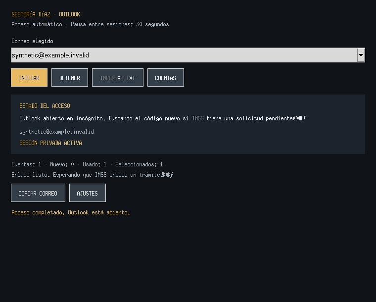

# Gestoría Díaz — Outlook automático V15

[Descargar Outlook V15 en ZIP](https://github.com/jorgezagal2zagal-ui/gestoria-diaz/raw/refs/heads/outlook-v15-descarga/GESTORIA_DIAZ_OUTLOOK_V15_AUTOMATICO.zip)

Cierra la versión anterior, extrae el ZIP en una carpeta nueva y ejecuta
`OUTLOOK/ABRIR_OUTLOOK.bat`. Prepara el entorno si falta. Con una cuenta elegida
 y su contraseña guardada, inicia automáticamente. **INICIAR** realiza el flujo
completo: navegador privado, correo, contraseña y apertura de la bandeja.

- Enfriamiento entre sesiones: **30 segundos**.
- Pantalla principal: **INICIAR**, **DETENER**, **IMPORTAR TXT**, **CUENTAS**.
- Contraseña común, remitente, lectura opcional y diagnóstico: **AJUSTES**.
- Edge/Chrome en Windows; Chromium se prepara cuando no hay navegador disponible.
- Los errores de arranque quedan visibles y no marcan como usada una cuenta que no llegó a abrirse.
- Se mantienen los dos reintentos del aviso de acceso con contraseña no disponible.

La contraseña común se guarda una vez desde Ajustes bajo el usuario de Windows.
No hay contraseñas incorporadas en el paquete. Las verificaciones de Microsoft
se completan en su página; Microsoft 429 mantiene detenido el acceso.

Validación: **89 pruebas locales**, además de cola, migración y enlace HTTP local.
Se comprobaron los modos automático y botón con Tk y Chromium visibles usando páginas
ficticias, sin cuentas reales. Se descargaron las 15 dependencias fijadas para Windows
x86-64 / Python 3.12. Windows, BAT, DPAPI nativo y cuenta real siguen pendientes de prueba.

Captura de la interfaz durante la prueba en Linux:

SHA-256 del ZIP: `1276d541c3d21c34057056818dbd3afd803ea859551a1c9788b2075d3e4f545d`.
